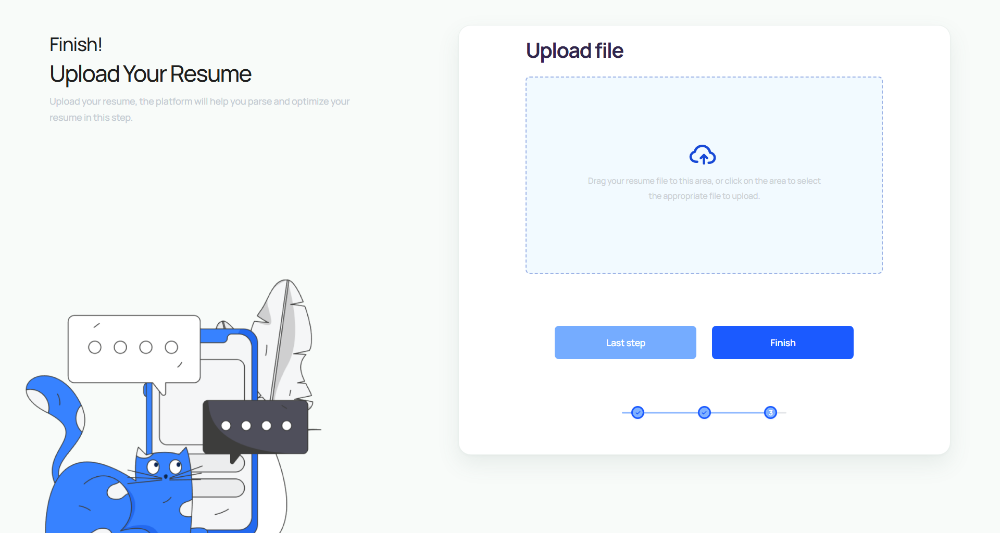

# Resume Upload Page

基于 Figma 设计稿实现的简历上传页面，使用 React + Vite 构建。项目包含桌面端与移动端适配，以及完整的上传交互、文件校验和可访问性状态。



## 功能

- 点击上传区域，调用系统文件选择器。
- 支持拖拽上传，并提供拖入、Hover、聚焦、按下等交互状态。
- 支持 PDF、DOC、DOCX、TXT 文件，单个文件最大 10 MB。
- 上传后展示文件名和格式化后的文件大小。
- 文件类型或大小不符合要求时显示行内错误提示，并可重新选择。
- `Last step` 和 `Finish` 提供当前流程对应的反馈；未上传文件时不会直接完成。
- 支持键盘操作、屏幕阅读器文本与减少动画偏好。
- 桌面端双栏布局，在较窄屏幕下自动切换为单栏布局。

## 技术栈

- React 19
- Vite 7
- 原生 CSS
- 本地 Manrope 字体资源

## 环境要求

- Node.js `20.19+` 或 `22.12+`
- npm `10+`

建议使用当前 Node.js LTS 版本。可通过以下命令确认版本：

```bash
node --version
npm --version
```

## 安装与运行

```bash
npm ci
npm run dev
```

终端会输出本地访问地址，通常为 `http://localhost:5173/`。

## 生产构建

```bash
npm run build
npm run preview
```

构建产物位于 `dist/`，`npm run preview` 可启动生产构建的本地预览。若需要部署到静态托管平台，发布 `dist/` 目录即可。

## 可用命令

| 命令 | 说明 |
| --- | --- |
| `npm run dev` | 启动本地开发服务 |
| `npm run build` | 生成生产构建 |
| `npm run preview` | 预览生产构建 |

## 交互与校验规则

- 接受扩展名：`.pdf`、`.doc`、`.docx`、`.txt`。
- 文件大小上限：`10 MB`。
- 校验失败时保留当前页面，并显示错误信息。
- 再次点击或拖入文件即可替换当前选择。
- 选择有效文件后，上传区域展示文件名和文件大小。

## 项目结构

```text
.
├── docs/
│   └── preview.png
├── src/
│   ├── assets/
│   │   ├── manrope-latin.woff2
│   │   └── resume-illustration.png
│   ├── App.jsx
│   ├── main.jsx
│   └── styles.css
├── index.html
├── package.json
├── package-lock.json
└── vite.config.js
```

## 说明

这是纯前端实现，文件仅在浏览器中读取和展示，不会上传到服务器；刷新页面后已选择的文件信息会被清除。
